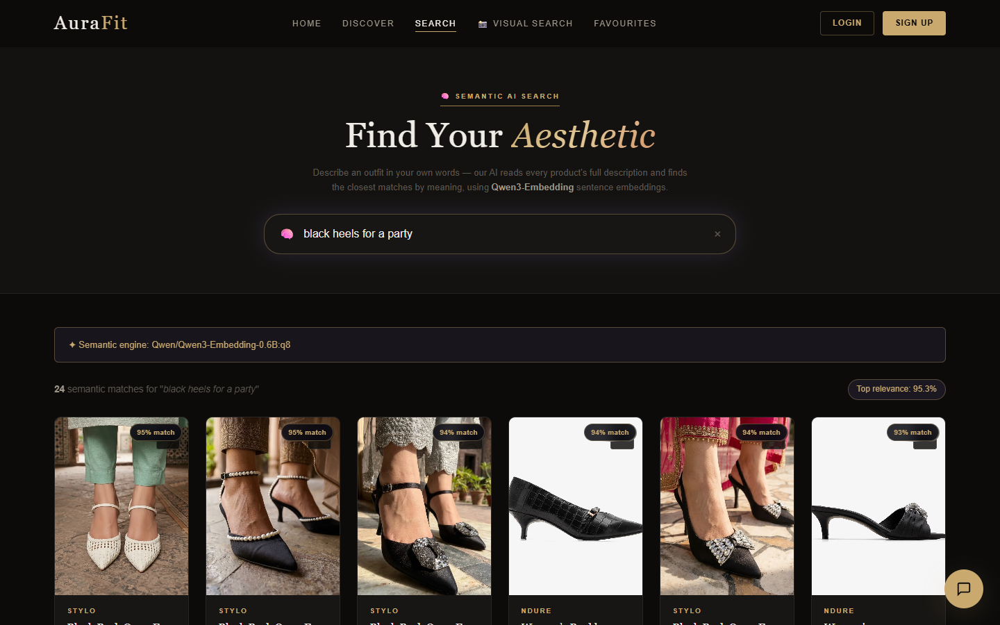
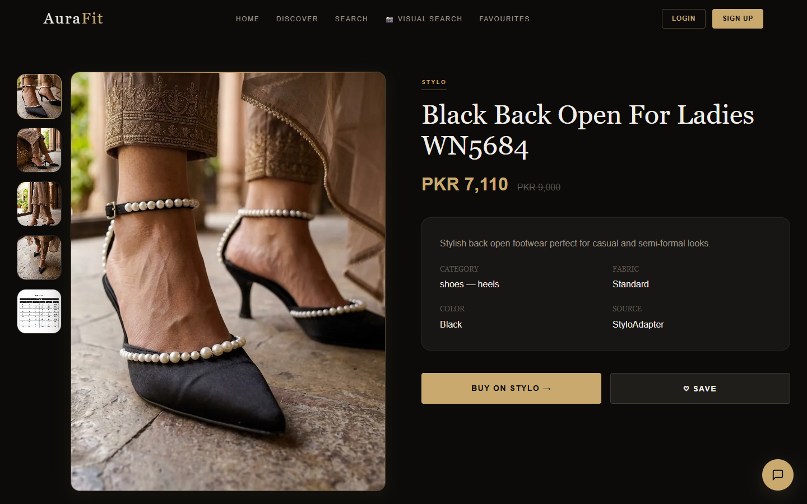
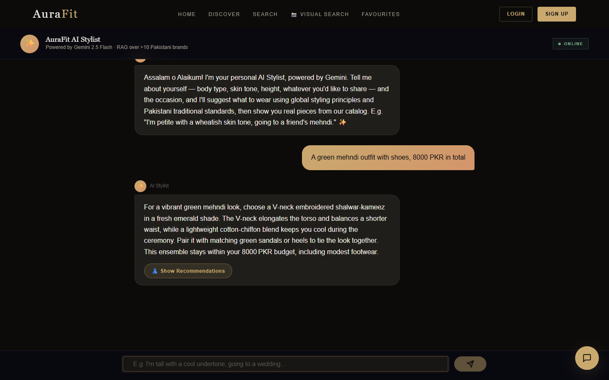
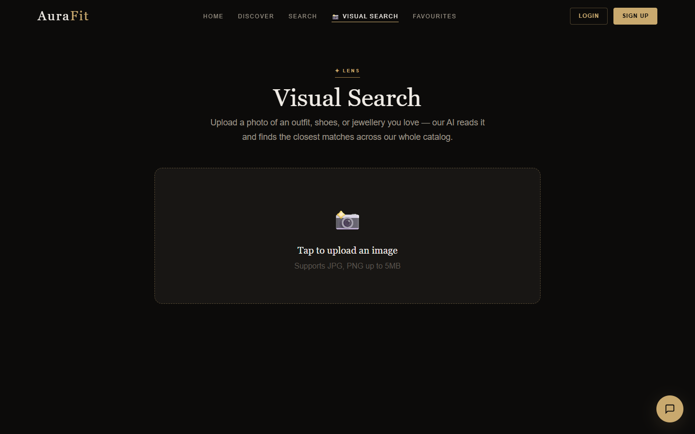
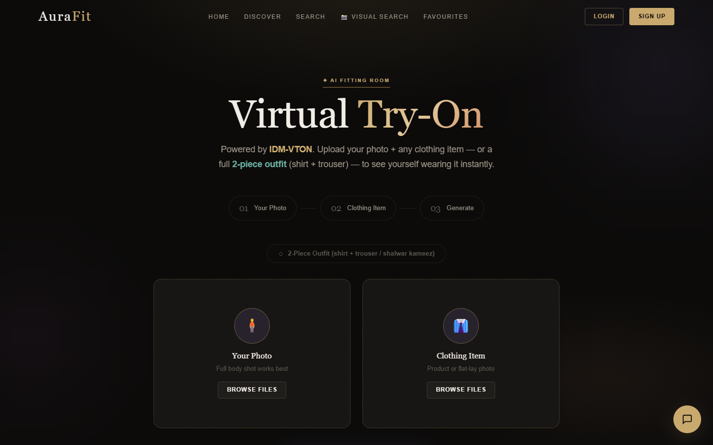
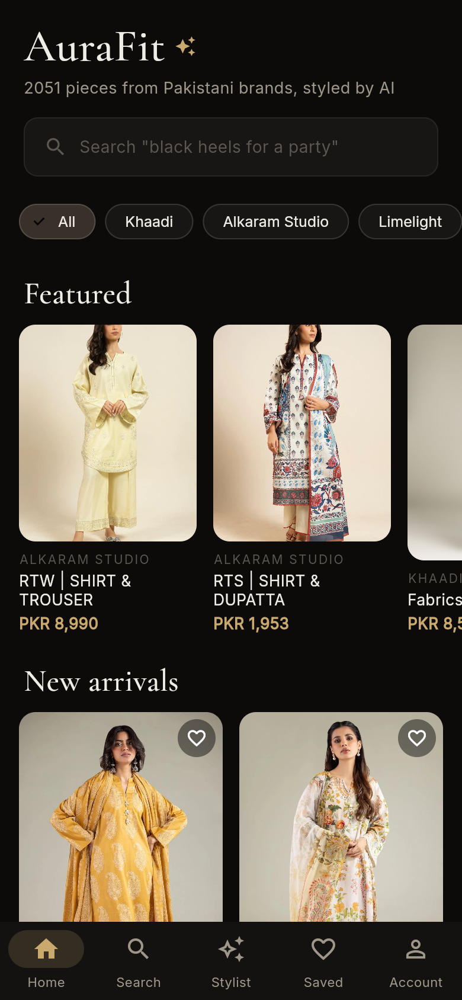
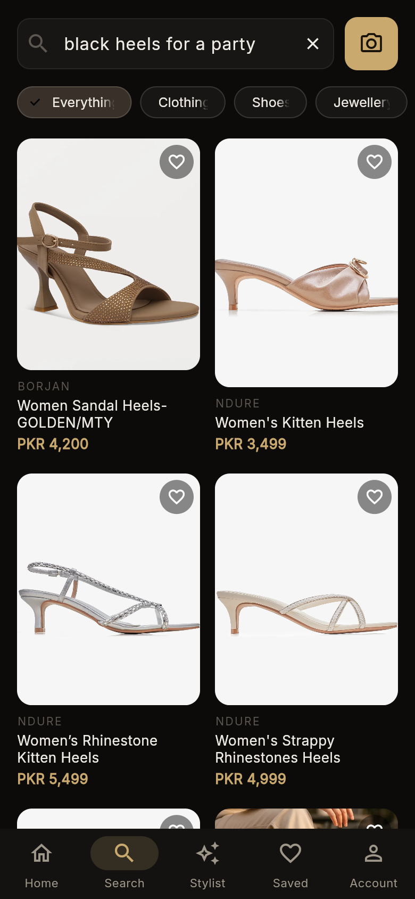
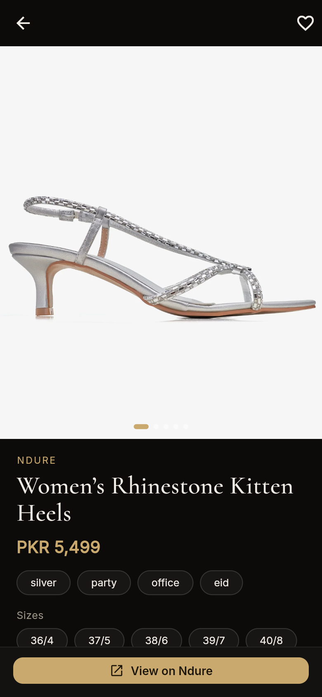
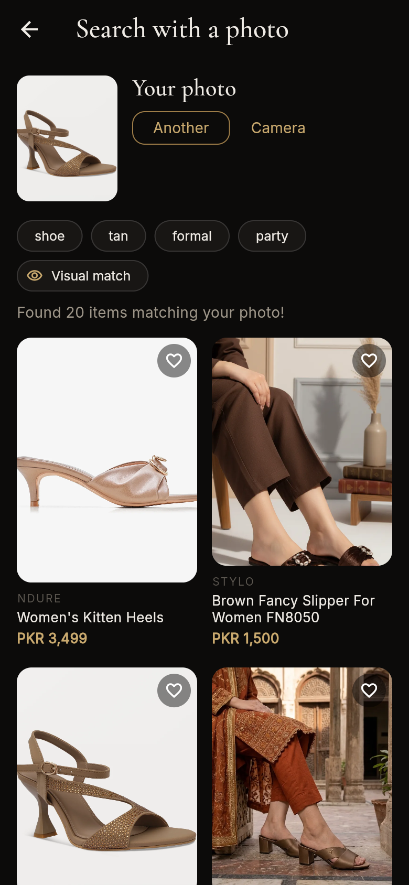
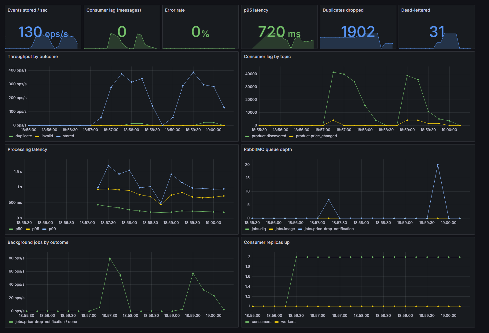

# AuraFit — AI-Powered Pakistani Fashion Platform

> A fashion discovery, outfit-recommendation and virtual try-on platform for the Pakistani market. AuraFit scrapes real products from Pakistani fashion retailers into four catalogs (clothing, shoes, jewellery, watches) and answers natural-language requests such as *"a green mehndi outfit with shoes, 8000 PKR in total"* with real, in-stock products and honest reasons. It has a Next.js web app, a Flutter mobile app, an agentic stylist (LangGraph + MCP), local semantic and visual search, and an event-driven ingestion pipeline (Kafka, RabbitMQ, Redis) with monitoring (Prometheus, Grafana, Alertmanager).

## At a glance

| | |
|---|---|
| **Catalog (live, in stock)** | 3,315 products: clothing 2,051 · shoes 565 · jewellery 643 · watches 56 |
| **Retailers** | 14 scraped live. Elan (15th) is configured but offline (its site returns HTTP 500; its TLS certificate had also expired) |
| **Search quality** (35 judged queries) | precision@10 0.771 · recall 0.837 · MRR 0.948 · nDCG 0.880 |
| **Vector search** | Atlas Vector Search on 3 of 4 catalogs (free tier allows 3 indexes; watches, 56 items, stay in-process): recall@20 1.000 vs exact, same eval scores as before |
| **Photo search** | same product type in the top 5 for 70% of photos, same catalog for 98% |
| **Stylist agent** (13 graded tasks) | 13/13 pass: budget, colour, requested categories, grounding, stock, prompt-injection |
| **API under load** (20 connections) | product list 924 req/s (p97.5 37 ms) · semantic search 63 req/s (p97.5 571 ms) |
| **Pipeline** (Kafka, crash-tested) | 22,000 events, 0 lost, 0 duplicated, with consumers killed mid-run |
| **Tests** | 437 backend + 48 pipeline, plus a real-Kafka end-to-end job in CI |

Every number above is measured by a script in this repo and explained in [docs/PLAN.md](docs/PLAN.md), including what was *not* measured. Deeper docs:
[architecture](docs/architecture.md) · [RAG / embeddings](docs/rag-architecture.md) · [agent and MCP](docs/agent-and-mcp.md) · [deployment](docs/deploy.md) · [why these brokers](docs/why-these-brokers.md) · [results](docs/results/README.md).

---

## Table of Contents

- [Screenshots](#screenshots)
- [Overview](#overview)
- [Features](#features)
- [Mobile App (Flutter)](#mobile-app-flutter)
- [Tech Stack](#tech-stack)
- [Agentic Stylist and MCP](#agentic-stylist-and-mcp)
- [Event-Driven Ingestion Pipeline](#event-driven-ingestion-pipeline)
- [System Architecture](#system-architecture)
- [Project Structure](#project-structure)
- [Database Models](#database-models)
- [Recommendation Engine — Agentic Relaxation Loop](#recommendation-engine--agentic-relaxation-loop)
- [Personal Stylist](#personal-stylist)
- [Search — Keyword + Semantic, Cross-Catalog](#search--keyword--semantic-cross-catalog)
- [Visual Search](#visual-search)
- [Product-Page AI Accessory Picks](#product-page-ai-accessory-picks)
- [Virtual Try-On](#virtual-try-on)
- [Self-Healing Data Pipeline](#self-healing-data-pipeline)
- [Scraper Pipeline](#scraper-pipeline)
- [Multi-Provider AI Fallback Chain](#multi-provider-ai-fallback-chain)
- [Color Theory Engine](#color-theory-engine)
- [Evaluation and Quality](#evaluation-and-quality)
- [Observability and Security](#observability-and-security)
- [API Reference](#api-reference)
- [Environment Variables](#environment-variables)
- [Getting Started](#getting-started)
- [Scripts Reference](#scripts-reference)
- [Testing](#testing)

---

## Screenshots

### Web (Next.js)

| Home | Semantic search: "black heels for a party" |
|---|---|
|  |  |

| Product page | Stylist chat |
|---|---|
|  |  |

| Visual search | Virtual try-on |
|---|---|
|  |  |

### Mobile (Flutter)

Captured from the Flutter web build at phone size, against the real API (semantic and visual search on).

| Home | Search | Product | Stylist | Photo search |
|---|---|---|---|---|
|  |  |  |  |  |

The stylist screenshot is a real answer: *"A green mehndi outfit with shoes, 8000 PKR in total"* returned a suit (PKR 4,699), slippers (PKR 1,470) and a necklace, within budget, after 2 catalog lookups. The photo-search shot starts from a photo of a sandal and shows the "Visual match" chip (image embeddings, not just tags).

Not pictured: the admin console (it shows user emails and server logs) and a generated try-on (it needs a person's photo, and none was used).

---

## Overview

Pakistani fashion shoppers have no single intelligent platform that aggregates products across the country's top brands and gives **honest, complete-outfit** recommendations. AuraFit solves this with:

- **Four independently-scraped catalogs** — clothing (2,051 in stock / 8 brands live), shoes (565 / 5), jewellery (643), watches (56) — normalized into a rich, structured schema (exact color shade *and* canonical family, dress style, stitching, piece count, fabric, print, occasion, and a `styleCode` taken from the product URL because 58% of clothing rows share a generic title).
- **An agentic recommendation loop**: an LLM sees real-time DB counts for every possible constraint relaxation and decides — round by round — whether to relax a filter, raise the budget, accept, or honestly report nothing was found. It never pads results to a fixed count.
- **Self-healing data**: when the engine touches a product whose scraped field (dress style, fabric, gender, shoe silhouette, missing occasion tag) doesn't match its own title/description, it re-derives the correct value and writes the fix back to MongoDB — the catalog gets cleaner through normal use, with no full re-scrape needed.
- **Cross-catalog search** — one query box (keyword or semantic) searches clothing + shoes + jewellery + watches together and ranks results by relevance, so "black heels" surfaces shoes and "gold jhumka" surfaces jewellery, automatically.
- **World-standard styling logic** for accessory pairing: color-theory contrast (bold dress → neutral shoe), occasion-appropriate silhouette, and jewellery weight (statement vs minimal) based on the occasion.
- **Free-first, local-first AI**: text LLMs use a provider chain (Groq → Gemini → OpenRouter, optional local Ollama) with a circuit breaker and a startup self-test. Embeddings run **locally** (Qwen3 for text, FashionCLIP for photos): no API key and no per-call cost. On a host too small to hold the models (under 1.8 GB of RAM) the API detects that and serves keyword search instead of crashing. Every capability degrades instead of failing.

---

## Features

### 🧵 Multi-Catalog Product Data
- **Clothing** (2,051 in stock) — Khaadi, Alkaram Studio, Limelight, Zellbury, Gul Ahmed, Beechtree, Maria B, Sana Safinaz (Elan is configured; its site is down)
- **Shoes** (565 in stock) — Stylo, ECS, Borjan, Ndure, Hush Puppies
- **Jewellery** (643 in stock) — Maria B, Limelight, Gul Ahmed, J., Stylo
- **Watches** (56 in stock) — ECS, Stylo (Limelight has no watch collection; a scraper bug used to fill it with clothing, fixed)
- Dual color storage on every item: `primaryExactColor` (scraped shade, e.g. `"maroon"`) *and* `primaryColor` (canonical family, e.g. `"Red"`) — lets the engine match a user's exact shade first, then fall back to the family.
- **3-strategy waterfall scraping**: Shopify JSON API → site-wide listing crawl → Cheerio HTML parsing, per brand.

### 🤖 Agentic "Style Me" Recommendations
- Natural-language intent parsing (color, occasion, dress style, neckline, print, stitching, piece count, fabric, season, budget, accessory type) via a multi-provider LLM chain.
- **Hard vs. soft constraints**: gender is always hard; budget is hard *only if the user mentions a price* (no price → no filter, nothing to relax); every other attribute — including neckline, a lower-priority signal since only ~12% of the catalog has it structured — is soft and only filtered if the user mentioned it.
- **Gender safety net**: the catalog is 100% women's inventory, and gender is a hard, never-relaxed filter, so a wrong "men"/"kids" guess from an ambiguous garment word (kurta/shalwar-kameez are unisex-named in Pakistani fashion) used to silently zero out results with no way to recover. A non-"women" gender guess is now only honored if the original message has real corroborating text (e.g. "for my husband") — otherwise it defaults to "women", which the catalog can always actually serve.
- **Agentic relaxation loop**: each round, the LLM sees the *actual* catalog count for every possible next relaxation (`"drop print → 12 results"`, `"drop occasion → 40 results"`, `"lift budget → 3 results, cheapest PKR 8,900"`) and picks the single best move — relax the least-important filter, raise the budget, accept, or stop. Capped at `RELAXABLE.length + 2` rounds (10) — high enough that a rich, multi-constraint query (color + occasion + dress style + neckline + stitching + pieces + fabric + season) can always fully relax down to a real match rather than silently exhausting its round budget at zero results.
- **Never pads results** — accepts the tightest constraint level with *any* matches (even 1); only relaxes further when a level returns zero.
- **Honest match reasons**: a deterministic fact-checker (`describeMatch`) cross-checks every AI-generated reason against the product's actual fields (color, pieces, stitching, dress style, print, occasion, budget) and overrides it with an honest "Matches X, Y; but Z" sentence whenever the AI reason would misstate anything.
- **World-standard styling protocol** baked into the ranking prompt: heavy embroidery/velvet/organza → weddings/festive; lawn/cotton → summer/casual; seasonal fabric penalties; classic bridal palettes (maroon, bottle green, royal blue, gold); complete outfits ranked above single pieces.
- Per-result paired **shoe + jewellery**, chosen by color-contrast + occasion + silhouette scoring, each with its own honest reason.

### 👤 Personal Stylist
- Describe yourself (body shape, skin tone, height, whatever you choose to share) and an occasion in plain language — the AI blends **global styling principles** (color theory by skin undertone, silhouettes that flatter different body shapes, proportion balancing, neckline choices) with **Pakistani traditional standards** (occasion-appropriate garments, modesty norms, seasonal fabric, traditional occasion colors) into genuine, specific advice.
- **Catalog-agnostic ground truth**: the styling advice itself always reflects real fashion standards regardless of what the catalog stocks — e.g. correctly recommending a saree/maxi/gown for a farewell party or a corporate annual dinner rather than defaulting to shalwar-kameez just because that's the catalog's deepest category, or over-recommending lehenga for non-bridal formal events.
- **Honest catalog-availability disclosure**: only the *search* is pivoted to what the catalog can actually serve (e.g. a maxi-dress ideal maps to the closest available `western` search) — the advice text says so explicitly (`idealStyleNotAvailable`) instead of silently substituting.
- One click ("Show Recommendations") runs the generated search prompt through the same agentic outfit engine described above.

### 🔍 Cross-Catalog Search
- **Keyword search** (`/api/search`) — MongoDB `$text` + regex fallback, unioned and ranked across all four catalogs in one request. Cached for 30 s with request coalescing.
- **Semantic search** (`/api/search/semantic`) — local **Qwen3-Embedding-0.6B** vectors (searched at 256 dimensions: measured within noise of 1024, at a quarter of the data) + a hybrid facet-alignment score (occasion / colour / garment / keyword overlap), merged across all four catalogs. Queries that name a product type rank that catalog first (*"black heels"* → shoes, *"ladies bracelet watch"* → watches, because the last product word is the head noun). On a small host the model is not loaded and this endpoint answers 503 with a pointer to keyword search; `/api/health` reports which mode is active.
- Both auto-relax their similarity floor and report it honestly when nothing scores above threshold, rather than silently returning irrelevant items.

### 📸 Visual Search
- Upload a photo (of an outfit, shoes, or jewellery) — a vision-capable LLM (Gemini) analyzes category / color / style / occasion / keywords.
- **Single-catalog scoping**: the photo shows exactly one item, so matches are restricted to that item's own catalog (`classifyCatalog()`) — a saree photo can no longer surface jewellery or shoes just because they scored competitively on color/occasion embedding.
- **Deliberately de-biased prompt**: explicit structural criteria distinguish visually-similar categories the vision model commonly confuses (e.g. saree's diagonal pallu drape vs. lehenga's separate stitched skirt + choli), and color-analysis guidance prevents pale/pastel shades (mint, sage, baby pink) from defaulting to "off-white" just because the example text anchored toward that phrase.
- **Same agentic honesty for clothing photos**: instead of a plain similarity threshold, a clothing photo's derived intent (dress style/color/occasion) runs through the identical progressive-relaxation engine used by text search, so a photo of a rare style (e.g. saree — only a couple in stock) gets an honest "no exact match, here's what we relaxed" instead of silently substituting or returning nothing.
- **Human-in-the-loop refinement**: after seeing results, free-text feedback like *"prioritize saree, color can change"* (`POST /api/search/visual/refine`) re-runs the same agentic engine with that instruction folded directly into what the relaxation planner reads — no re-upload needed.
- Regex fallback (checking both canonical color family *and* exact shade) when no embedding provider is configured.
- **Pixel-level similarity**: every product photo has a **FashionCLIP** vector (local, 512-dim). An uploaded photo is compared with all of them and that ranking is fused (reciprocal-rank fusion) with the description-based one, so print, silhouette and embellishment count, not just what a vision LLM can put into words. The model was chosen by measurement over general CLIP and Marqo-FashionCLIP ([docs/rag-architecture.md](docs/rag-architecture.md)). Best-effort: without the model (small host) it falls back to description-only.

### 🧥👠 Product-Page AI Accessory Picks
- "Complete the Look" (shoes + complementary clothing) on every product page uses the same footwear-matching logic as the outfit builder (`accessoryMatcher.js`) — including a **silhouette-mismatch guard**: eastern traditional wear (shalwar-kameez, kurta, lehenga, saree, abaya) is never paired with Western athletic shoes (sneakers/trainers/joggers) regardless of how "casual" the occasion is, a real global + Pakistani pairing standard the old occasion-only heuristic missed.
- **Agentic widen-and-retry loop**: the heuristically pre-filtered candidate pool (with full product descriptions, not just structured fields) is handed to an LLM that picks the best matches and explains each with a genuine, specific reason. If it judges the pool itself insufficient, the pool automatically widens and it's asked again — up to 3 rounds — instead of ever settling for a too-narrow first batch.

### 👗 Virtual Try-On
- Puts a product's image onto the user's saved profile picture using IDM-VTON.
- **Free-first, two-provider fallback**: tries the free Hugging Face Space (`yisol/IDM-VTON`, shared ZeroGPU hardware — no billing required) first; Replicate (paid, fast, ~30–90s) is an opportunistic fallback used automatically if it's configured with credit.
- **Photo validation + auto-extension**: a vision check rejects unusable photos (no person, face not visible, more than a minor crop missing) upfront rather than generating a broken result; a nearly-full-length photo missing only feet/ankles is automatically extended (outpainted) instead of rejected.
- "Try On Yourself" button on every clothing product card (not shown for shoes/jewellery/watches, where virtual try-on has no meaning); prompts to log in / set a profile picture if either is missing.
- **Async jobs**: `POST /api/tryon/jobs` returns `202` immediately; poll `GET /api/tryon/jobs/:id` or stream `GET /api/tryon/jobs/:id/events` (Server-Sent Events). Bounded concurrency and queue, a result cache keyed by a hash of the images, de-duplication of identical in-flight requests, a per-user cap and per-job timeouts. The old synchronous `POST /api/tryon` still works but holds the request open for 60–120 s.

### 🩹 Self-Healing Catalog
- Query-time re-derivation + DB write-back for: clothing `dressStyle`/`fabric`, shoe `gender`/`shoeType`/missing `casual` occasion tags, jewellery `jewelryType` and non-jewellery contamination (footwear/bags scraped into the jewellery collection from mixed-catalog source pages).
- Title is treated as the authoritative source for structural fields; description is noisy marketing prose except for specific structured sub-patterns (`"Fabric:"`, `"Color:"`, `"What You'll Get:"` with negation-awareness).

### 🖼️ Profile Pictures & Cloudinary
- Optional avatar at registration or anytime from `/account`; used as the "person" image for AI Virtual Try-On.
- Explicit-credential Cloudinary integration (parses `CLOUDINARY_URL` and passes credentials directly to the SDK, rather than relying on its own env auto-read, which is unreliable given this app's ES-module import order).

### 🛍️ Discovery, Favorites & Admin
- Filterable product browser, autocomplete suggestions, pagination.
- JWT auth (30-day tokens), personal favorites, saved outfit boards, digital wardrobe (Gemini vision auto-tagging).
- Admin dashboard: live scraper status via Server-Sent Events, manual scrape trigger, per-brand scrape history, product stats, brand deletion, catalog lexical audit, system logs.

### 🧠 Agentic Stylist and MCP
- `POST /api/stylist/ask` runs a **LangGraph** agent (search, product details, accessory pairing, compatibility scoring) with a hard budget (steps, tool calls, time), **grounded answers** (it can only recommend products a tool returned), untrusted-data handling for scraped text, a **verify-and-revise step** (stated budgets and named categories are checked after the answer) and a deterministic fallback when no LLM is reachable.
- The same read-only tools are exposed as an **MCP server** (stdio for Claude Desktop / IDEs, authenticated HTTP at `/mcp`). See [docs/agent-and-mcp.md](docs/agent-and-mcp.md).

### 📈 Production hardening
- **Security**: SSRF guard on every server-side download, magic-byte upload validation, prompt-injection hardening, per-caller quotas on costly endpoints, 0 known production vulnerabilities.
- **Reliability**: circuit breakers (shared across instances through Redis), request ids and structured logs, fail-open Redis, graceful degradation on small hosts.
- **Observability**: Prometheus metrics, Grafana dashboards, 10 alert rules, Alertmanager.
- **Quality gates**: golden-query search eval, photo-search eval, agent eval and outfit eval, run weekly in CI where they are cheap.
- **Weekly refresh**: a scheduled GitHub Actions job re-scrapes every brand, marks sold-out items, embeds new and changed products and fails loudly if a catalog loses most of its stock.

### 📱 Mobile app (Flutter)
- A native-feeling Flutter client for the same API: browse, search, product pages with "complete the look", the AI stylist chat, photo search, virtual try-on and favourites. See [Mobile app](#mobile-app-flutter).

---

## Mobile App (Flutter)

`mobile/` is a Flutter client for the same API (Android, iOS and web from one codebase).

| Tab | What it does |
|---|---|
| **Home** | featured pieces, brand filter, endless "new arrivals" |
| **Search** | one box over clothing, shoes, jewellery and watches; the camera button searches with a photo |
| **Stylist** | chat with the agentic stylist (`POST /api/stylist/ask`); each pick shows why it was chosen |
| **Saved** | favourites (needs an account) |
| **Account** | sign in / register, and the server address with a "Save and test" check (reports semantic vs keyword search) |

Product pages add the gallery, "shoes to match" and "pairs well with", **Try on** (a background job: submit, then poll the queue) and a link to the retailer.

```bash
cd mobile && flutter pub get
flutter run -d chrome                                          # talks to http://localhost:5000/api
flutter run --dart-define=API_BASE_URL=https://your-server/api
flutter analyze && flutter test                                # 43 tests, no server needed
```

Honest limits: tokens are in plain `shared_preferences` (use the keychain before a store release), there is no offline catalog or push, and it has not been run on a physical iOS device (no Mac here). Details in [mobile/README.md](mobile/README.md).

---

## Tech Stack

| Layer | Technology |
|-------|-----------|
| Web | Next.js 16 (App Router), React, TypeScript |
| Mobile | Flutter (Android / iOS / web), Dart |
| Styling | Vanilla CSS — custom Editorial Fashion design system |
| HTTP Client | Axios with JWT interceptors |
| Backend | Node.js, Express 4 (ES Modules) |
| Database | MongoDB via Mongoose 8 |
| Authentication | JWT (jsonwebtoken), bcryptjs |
| AI — Text | Provider chain, order configurable (`LLM_PROVIDER_ORDER`): Groq (`gpt-oss`) → Gemini 3.x → OpenRouter; optional local Ollama. Circuit breaker, per-feature timeouts, startup self-test (`npm run llm:selftest`) |
| AI — Vision | Gemini 3.x |
| Text embeddings | Qwen3-Embedding-0.6B, local (no API key), searched at 256 dims (measured vs 1024: [docs/rag-architecture.md](docs/rag-architecture.md)) |
| Vector database | **MongoDB Atlas Vector Search** (`$vectorSearch`, HNSW, cosine): one index per catalog holding the text (1024-d) and photo (512-d) vectors, pre-filtered by stock, model, gender and category. Recall vs exact search 1.000; search quality identical to the in-process path. Falls back to in-process search per catalog if an index is missing |
| Image embeddings | FashionCLIP (fashion-tuned CLIP, local, pinned revision), chosen over general CLIP and Marqo-FashionCLIP by measurement; photo search fuses visual similarity with the description-based ranking |
| Agent / MCP | LangGraph stylist agent (`POST /api/stylist/ask`) and an MCP server (stdio + HTTP) over the same read-only tools: [docs/agent-and-mcp.md](docs/agent-and-mcp.md) |
| Virtual Try-On (paid) | Replicate `IDM-VTON` |
| Virtual Try-On (free) | Hugging Face Space `yisol/IDM-VTON` via `@gradio/client` |
| Image Hosting | Cloudinary |
| Web Scraping | Axios, Cheerio |
| Scheduling | node-cron |
| Security | Helmet, CORS, express-rate-limit (Redis-backed when available), per-caller quotas, SSRF guard, upload validation |
| Messaging / cache | Kafka (kafkajs), RabbitMQ, Redis |
| Observability | Prometheus, Grafana, Alertmanager (`prom-client`) |
| CI / CD | GitHub Actions: tests, multi-service e2e, weekly catalog refresh + quality gate, deploy job (not yet run) |
| Testing | Node's built-in `node --test` + Supertest, Flutter test |

---

## Agentic Stylist and MCP

Open-ended requests ("a budget outfit for my cousin's mehndi, I love green, under 8000 PKR") go to an agent that decides what to look up, instead of a fixed pipeline.

```
POST /api/stylist/ask { "message": "..." }

START -> decide --(tool)--> act --> decide ...
            |
            +--(final)--> verify --(breaks a stated budget / named category, once)--> decide
            |               |
            |               +--(ok)--> END
            +--(budget exhausted | LLM down)--> END (deterministic fallback)
```

| Tool (all read-only) | Purpose |
|---|---|
| `search_catalog` | semantic + facet search across all four catalogs, in stock only, optional catalog / gender / max price |
| `get_product` | full details of one product |
| `suggest_accessories` | best shoe, jewellery set and watch for an outfit, each with a reason |
| `score_pair` | compatibility (0-1) of two products |
| `get_wardrobe` | the signed-in user's saved items |

What keeps it honest: a hard step / tool / time budget; picks must come from tool results (invented ids are dropped); scraped text is wrapped as untrusted data; a budget or a category the shopper asked for is checked by code and the model is sent back once with the exact problem; every tool is read-only (asserted by a test), so the loop cannot spend money or change data.
The same tools are served over **MCP** (stdio for Claude Desktop, authenticated HTTP at `/mcp`). Measured results and the bugs the evaluation found: [docs/agent-and-mcp.md](docs/agent-and-mcp.md).

---

## Event-Driven Ingestion Pipeline

The scraper no longer just writes to MongoDB: it publishes events, and independent services react to them.

```
Scraper ──► Kafka ──► Consumer ──► MongoDB
                        │  └─ invalid / failed ──► dead-letter topic
                        └──► RabbitMQ ──► Worker (images → Cloudinary, price-drop notifications)
                 Redis: API cache · rate limiting · dedupe · locks
                 Prometheus + Grafana: lag · queue depth · error rate · latency
```

Full diagram, delivery guarantees and failure modes: [docs/architecture.md](docs/architecture.md).
Why each broker is here: [docs/why-these-brokers.md](docs/why-these-brokers.md).

### Status

| Claim | Status |
|---|---|
| Event validation, dedupe, locks, retry/DLQ, worker idempotency, crash-resume, ordering | **Unit-tested** (48 tests, including a real in-memory MongoDB for the store), run in CI |
| Scraper and consumer agree on the event format | **Verified** by a contract test |
| Full stack via `docker compose up` | **Run end to end** (Kafka, RabbitMQ, Redis, Mongo, 2 consumers, worker, Prometheus, Grafana) |
| Load test and consumer-crash tests | **Run and passing**, see [Results](#results) |
| Monitoring | **Running**: Prometheus scrapes every replica; Grafana dashboards (39 validated queries); 10 alert rules routed through Alertmanager (delivery to a webhook verified) |
| CI | **Passing on GitHub** (PRs #1-#3): tests on every push/PR, both Docker images build, and the end-to-end job brings up Kafka, RabbitMQ, Redis and MongoDB on a runner and passes the load test (5,500 events), the consumer-SIGKILL test (11,000 events, 0 lost, 0 duplicated), the feedback test and the shared-circuit-breaker test |
| Search quality | **Measured**: 35 predicate-judged queries, P@10 0.771, recall 0.837, MRR 0.948, nDCG 0.880 (`npm run eval:search`); the baseline was restated downward after the eval itself was found to be lenient. Photo search: same product type in the top 5 for 70% of photos (`eval:visual`) |
| API performance | **Load-tested** (20 connections, real catalog): product list 924 req/s p97.5 37 ms, semantic search 63 req/s p97.5 571 ms; the test found and fixed an uncached "cached" endpoint. Details in [docs/PLAN.md](docs/PLAN.md) |
| Security | SSRF guard on server-side fetches, upload validation (magic bytes), prompt-injection hardening, per-caller quotas on costly endpoints, 0 known production vulnerabilities (`npm audit`) |
| Agent and MCP | **Verified live** and **measured** (`npm run eval:agent`: 13 tasks, 13/13 pass every programmatic check including budget, requested categories, grounding and prompt injection; one run, output varies). Verify-and-revise step catches budget overshoot and forgotten categories |
| Feedback events | API → Kafka → consumer → Mongo, idempotent. **Run against the real stack**: 200 stored exactly once under 100 duplicate deliveries, malformed events dead-lettered; also in the CI e2e job |
| CD (deploy) | **Implemented, not yet run.** On `main` the pipeline publishes images to GHCR and deploys over SSH with a health smoke test ([docs/deploy.md](docs/deploy.md)). It needs a server and the `DEPLOY_HOST`, `DEPLOY_USER` and `DEPLOY_SSH_KEY` settings, and is skipped until then. Nothing is deployed yet |

### Run it (one command)

```bash
docker compose up --build
```

| Service | URL |
|---|---|
| API | http://localhost:5000/api/health |
| Grafana (dashboards: pipeline + API/LLM) | http://localhost:3000 (login `admin` / `$GRAFANA_ADMIN_PASSWORD`, local default `change-me-local-only`) |
| Prometheus | http://localhost:9090 |
| RabbitMQ UI | http://localhost:15672 (guest / guest) |

Run a scrape that feeds the pipeline: `PIPELINE_ENABLED=true KAFKA_BROKERS=localhost:9092 npm run scrape` (in `backend/`).
Scale consumers with `docker compose up -d --scale consumer=2`.

### Prove it works

```bash
cd pipeline
npm run loadtest -- --products=20000 --dup=0.05 --invalid=50
npm run failuretest -- --products=20000 --mode=one   # SIGKILL one of two consumers mid-run
npm run failuretest -- --products=20000 --mode=all   # SIGKILL every consumer, restart later
```

Both print a PASS/FAIL verdict and write a JSON report to [docs/results/](docs/results/). The load test injects duplicates and malformed
messages; the failure test uses `docker kill` (SIGKILL: no graceful shutdown, no offset commit) and then checks the database for lost
events, duplicate events, and lost or duplicate price-drop notifications.

### Results

Single laptop, Docker Desktop, one Kafka broker, **2 consumer replicas + 1 worker** (everything shares the machine).
22,000 unique events per run (20,000 discovered + 2,000 price drops). Full reports and method: [docs/results/](docs/results/README.md).

| Scenario | Stored | Lost | Duplicate rows | Notifications | Throughput |
|---|---|---|---|---|---|
| Load test (+1,000 redelivered duplicates, +50 malformed) | 22,000 | **0** | **0** | 2,000 / 2,000 | 328-383 events/s |
| `SIGKILL` 1 of 2 consumers mid-run (~16-18k messages unprocessed) | 22,000 | **0** | **0** | 2,000 / 2,000 | 269-325 events/s incl. recovery |
| `SIGKILL` both consumers mid-run, restart after 8 s | 22,000 | **0** | **0** | 2,000 / 2,000 | 265 events/s incl. recovery |

All 50 malformed messages were dead-lettered and none stored. The first crash run actually *failed* (24 of 2,000 jobs lost);
the tests found three real bugs, all fixed, described in [docs/results/](docs/results/README.md#what-the-tests-found-and-fixed).
Scope: consumer crashes on a single broker. Broker, Mongo and Redis failures were not tested.



### Pipeline tests (no Docker needed)

```bash
cd pipeline && npm test      # validation, dedupe, locks, handler, workers, scraper<->consumer contract
cd backend && npm test
```

## System Architecture

```
 Web (Next.js)                 Mobile (Flutter)                 External AI clients
      │                              │                                  │ MCP (stdio / HTTP)
      └──────────────┬───────────────┘                                  │
                     │ REST + JWT                                       │
┌────────────────────▼──────────────────────────────────────────────────▼───────────┐
│                               Express API (Node 20)                                │
│  request id → helmet → CORS → rate limit → routes → controllers → services         │
│  /api/auth /products /search /search/semantic /search/visual /recommendations      │
│  /stylist/ask /tryon (+ /jobs) /feedback /favorites /outfits /wardrobe /admin /mcp │
└──┬──────────────┬───────────────┬──────────────┬───────────────┬───────────────────┘
   │              │               │              │               │
┌──▼───────────┐ ┌▼─────────────┐ ┌▼────────────┐ ┌▼────────────┐ ┌▼──────────────────┐
│Recommendation│ │ Search       │ │ Agent       │ │ Try-on      │ │ Scraper (weekly   │
│engine        │ │ keyword +    │ │ LangGraph   │ │ job queue   │ │ GitHub Action)    │
│agentic       │ │ semantic     │ │ + MCP tools │ │ + SSE       │ │ 13 live retailers │
│relaxation,   │ │ (Qwen3) +    │ │ verify step │ │ HF Space →  │ │ 4 verticals       │
│self-healing, │ │ photo        │ │ grounding   │ │ Replicate   │ │ stock sweep       │
│colour theory │ │ (FashionCLIP)│ │             │ │             │ └─────────┬─────────┘
└──────┬───────┘ └──────┬───────┘ └──────┬──────┘ └──────┬──────┘           │ events
       └────────────────┴────────┬───────┴───────────────┘                  ▼
                                 │                          ┌───────────────────────────┐
                    ┌────────────▼─────────────┐            │ Kafka → consumer → Mongo  │
                    │ MongoDB                   │◄───────────┤ RabbitMQ → image/notify   │
                    │ 4 catalogs + users, etc.  │            │ workers · Redis · DLQ     │
                    └───────────────────────────┘            └─────────────┬─────────────┘
                                                                           │ /metrics
              ┌───────────────────────────────────────┐        ┌───────────▼─────────────┐
              │ AI providers (per capability)         │        │ Prometheus → Grafana    │
              │ Text:   Groq → Gemini → OpenRouter    │        │ Alertmanager (webhook / │
              │ Vision: Gemini                        │        │ Slack)                  │
              │ Embed:  Qwen3 + FashionCLIP (local)   │        └─────────────────────────┘
              │ Try-on: HF Space (free) → Replicate   │
              │ Images: Cloudinary                    │
              └───────────────────────────────────────┘
```

### Request flow — "Style Me" (agentic relaxation)

```
User: "bottle green 2pc embroidered dress under 5000"
   │
   ▼
Intent parsing (provider chain)
   │  color=bottle green, pieces=2, print=embroidered, budget=5000
   ▼
┌─────────────── Agentic Relaxation Loop (max 10 rounds) ──────────────┐
│ Round N: fetch pool at current constraint level, self-heal in-place  │
│   ├─ pool.length ≥ 1 → ACCEPT, show honestly what's found            │
│   └─ pool.length = 0 → probe every possible next relaxation's count, │
│      probe budget-lift count + cheapest price, ask the LLM:          │
│      "relax X" | "raise_budget" | "accept" | "stop"                  │
└────────────────────────────────────────────────────────────────────┘
   ▼
AI ranking (top candidates → ranked list + per-item reason)
   │  reason fact-checked against real fields; dishonest AI reasons
   │  overridden by describeMatch()
   ▼
Per-result shoe + jewellery pairing (color contrast + occasion + silhouette)
   ▼
Response: { results[], matchQuality: { tier, message }, relaxationMessage,
            refinementTrace: [ { action, constraint, note } ] }
```

---

## Project Structure

```
Fashion/
├── backend/                       # Express API, scrapers, AI services (Node 20, ESM)
│   ├── app.js  server.js          # app factory / entrypoint (boot log reports the memory policy)
│   ├── routes/  controllers/      # thin wiring; stylist, feedback, tryon (jobs + SSE), mcp, search, ...
│   ├── middleware/                # auth, quota (per-caller daily limits), uploads (magic bytes), cache, requestLogger
│   ├── models/                    # Clothing/Shoe/Jewelry/Watch products, User, Favorite, Outfit, TryOnJob, ...
│   ├── services/
│   │   ├── recommendationEngine.js  aiService.js  accessoryMatcher.js  colorTheory.js
│   │   ├── crossCatalogSearch.js  searchQueryIntel.js  vectorCache.js  atlasVector.js  visualSearch.js
│   │   ├── embeddings.js (Qwen3)  imageEmbeddings.js (FashionCLIP)  memoryProfile.js
│   │   ├── llmClient.js  llmProviders.js  llmCircuitBreaker.js  llmHealth.js
│   │   ├── tryonQueue.js  tryonStore.js
│   │   └── agent/                 # tools.js  graph.js (LangGraph)  constraints.js  mcpServer.js
│   ├── events/                    # product + feedback events published to Kafka
│   ├── observability/             # Prometheus metrics
│   ├── scripts/
│   │   ├── scrapers/              # adapters, extractors, parsers, utils (3-strategy waterfall)
│   │   ├── refreshCatalog.js  evalSearch.js  evalVisual.js  evalAgent.js  evalOutfits.js
│   │   ├── loadTestApi.js  benchVectors.js  compareImageModels.js  llmSelfTest.js  mcpStdio.js
│   │   └── embedAll.js  embedImages.js  purgeMisclassified.js  clearCatalog.js  ...
│   ├── eval/                      # golden queries, agent tasks, committed baselines and results
│   ├── tests/  (+ *.test.js beside code)   # 437 tests, node --test
│   └── Dockerfile                 # Debian (glibc): onnxruntime cannot load on Alpine
├── frontend/                      # Next.js 16 (App Router) web app
├── mobile/                        # Flutter app (Android / iOS / web)
├── pipeline/                      # Kafka consumer + RabbitMQ worker, load / crash / feedback tests (48 tests)
├── observability/                 # Prometheus, alert rules, Alertmanager template, Grafana dashboards
├── docs/                          # architecture, RAG, agent + MCP, deploy, plan with measured results, screenshots
├── .github/workflows/             # ci.yml (tests, images, real-Kafka e2e) · weekly-refresh.yml (scrape, embed, quality gate)
└── docker-compose.yml             # Kafka, RabbitMQ, Redis, Mongo, consumer, worker, API, Prometheus, Alertmanager, Grafana
```

---

## Database Models

### ClothingProduct / ShoeProduct / JewelryProduct / WatchProduct
Four separate collections (not a single polymorphic `Product`), each with catalog-specific taxonomy but a shared shape for cross-catalog search:

| Field | Type | Notes |
|-------|------|-------|
| `name`, `brand`, `price`, `compareAtPrice`, `currency` | — | |
| `primaryColor` / `colors` | String / [String] | **Canonical family** (Red, Blue, Gold, Multicolor, …) |
| `primaryExactColor` / `exactColors` | String / [String] | **Exact scraped shade** (maroon, bottle green, …) |
| `occasion`, `style`, `tags`, `trendTags` | [String] | |
| `gender` | String | `women` \| `men` \| `kids` \| `unisex` — women-only catalog filter applied at scrape time |
| `images`, `imageUrl`, `description`, `productUrl` (unique) | — | |
| `embedding`, `embeddingModel` | [Number], String | HuggingFace sentence embedding for semantic search |
| `inStock`, `scrapedAt`, `updatedAt` | — | |

**ClothingProduct-specific:** `dressStyle` (saree/lehenga/frock/maxi/shalwar-kameez/kurta/co-ord/palazzo/western/…), `stitchedType`, `pieceType`, `pieceDetails.{totalCount,includes}`, `fabric`, `pattern`, `season`.

**ShoeProduct-specific:** `shoeType` (khussa/heel/pump/wedge/sandal/sneaker/boot/…), `subCategory`, `closure`, `heelHeight`, `sizes`.

**JewelryProduct-specific:** `jewelryType` (earring/ring/necklace/bangle/jhumka/maang-tikka/bridal-set/…), `jewelryCategory` (ear/neck/wrist/hand/head), `metalFinish`, `stoneWork`.

**WatchProduct-specific:** `watchType`, `dialShape`, `caseMaterial`, `strapType`, `movement`.

### User
`name`, `email` (unique), `password` (bcrypt), `role` (`user`\|`admin`), `profilePicture` (Cloudinary URL — used as the Try-On "person" image), `preferences.{occasions,styles,favoriteColors,budget}`, `favoriteProducts[]`.

### Other collections
`Favorite` (user↔product join), `Outfit` (saved AI combinations), `WardrobeItem` (user-uploaded, vision-tagged), `ScraperLog` (per-run audit trail), `SystemLog` (error/event log surfaced in the admin dashboard).

---

## Recommendation Engine — Agentic Relaxation Loop

Replaces static weighted scoring with a live, LLM-guided negotiation between what the user asked for and what the catalog actually has.

1. **Intent parsing** — LLM extracts every field the user specified (nothing is assumed for unspecified fields), including `neckline` (round/v-neck/boat-neck/collar/keyhole/halter/square/off-shoulder) when explicitly named.
2. **Constraint classification** — gender is always hard (with a text-corroboration safety net against ambiguous garment-word misclassification — see Features above); budget is hard only if mentioned; everything else, including neckline, is soft.
3. **Round loop** (`RELAXABLE.length + 2` = 10 rounds — sized to cover every relaxable constraint firing at once plus color's own two-step exact→family→none path, since a rich stylist-generated query can legitimately specify all of them simultaneously):
   - Fetch the candidate pool at the current constraint level; self-heal any drifted fields in-place and in the DB.
   - If **any** results exist, stop and show them — never relax further just to pad the count, and never inflate a small result set to a fixed size.
   - If zero results, probe the *actual* DB count for every possible next relaxation (drop occasion? drop print? drop neckline? drop exact color → color family? lift the budget ceiling — and what's the cheapest item if we do?), and ask the LLM to pick one action: `relax <constraint>`, `raise_budget`, `accept`, or `stop`.
4. **Ranking** — candidates are sent to the LLM with full descriptions and a world-standard-fashion-protocol system prompt (occasion/formality cues, seasonal fabric fit, Pakistani bridal color palettes, garment completeness).
5. **Honesty pass** — `describeMatch()` independently recomputes matched/missed attributes from the product's real fields; if the AI's reason would misstate anything (including occasion, which the AI often glossed over), it's replaced with a fact-checked sentence.
6. **Accessory pairing** — one shoe + a jewellery set per result, scored on color contrast (bold dress → neutral shoe gets a bonus), occasion overlap, and silhouette-formality fit; heavy jewellery for wedding/bridal/mehndi, minimal for office/casual.

The full decision trace is returned as `refinementTrace` so the frontend can show *why* results were relaxed, not just that they were. This exact loop (`agenticRelax`, exported from `recommendationEngine.js`) is reused verbatim by visual search for clothing photos and by the human-in-the-loop refinement endpoint — see below.

---

## Personal Stylist

```
"I have a slim figure, wheatish skin tone, 5'3", going to my annual dinner"
   │
   ▼
generatePersonalStyleAdvice() — two-step reasoning, explicit in the prompt:
   │
   │  STEP 1 — What's genuinely IDEAL here, purely by global + Pakistani
   │  traditional styling logic, completely ignoring catalog stock? Known
   │  occasion norms are named explicitly so the LLM doesn't default to
   │  shalwar-kameez as a "safe" answer: university farewells → saree/maxi/
   │  Western gown; annual dinner galas → saree/Western gown, NOT bridal-
   │  style lehenga; red carpet → Western gown; garden parties → maxi/flowy
   │  Western.
   │
   │  STEP 2 — SEPARATELY, map Step 1's ideal to what's actually searchable
   │  (kurta, shalwar-kameez, western, lehenga, co-ord, abaya, saree — the
   │  catalog's only real-inventory styles). If Step 1's ideal isn't stocked,
   │  say so honestly (idealStyleNotAvailable) — this constraint affects ONLY
   │  the search mapping, never Step 1's advice text.
   ▼
{ advice, searchPrompt, dressStyle, occasion, idealStyleNotAvailable }
   │  searchPrompt is defensively sanitized: unresolved "X or Y" alternatives
   │  collapsed to one decisive choice, regional qualifiers (sharara-style,
   │  anarkali-style) stripped, and any leaked catalog-unavailable word
   │  (maxi/gown/frock/...) swapped for the real pivoted dressStyle.
   ▼
"Show Recommendations" → searchPrompt runs through the same agentic outfit engine above
```

---

## Search — Keyword + Semantic, Cross-Catalog

Both search endpoints run against **all four catalogs simultaneously** and merge results by relevance, rather than being scoped to one collection:

| | Keyword (`/api/search`) | Semantic (`/api/search/semantic`) |
|---|---|---|
| Engine | MongoDB `$text` index, regex fallback for partial words (tiered: all terms first, then any, ranked by match quality) | Local Qwen3-Embedding cosine similarity (256 dims) + facet-alignment hybrid score + product-type hints |
| Cross-catalog | ✅ unions clothing/shoes/jewelry/watches, sorted by text score | ✅ same, sorted by hybrid score |
| Graceful degradation | Falls back to regex when `$text` finds nothing | 503 with a pointer to keyword search when the host has under 1.8 GB RAM (the model is not loaded); `GET /api/health` shows the active mode |
| Honesty | Reports the true merged total across catalogs | Reports `relaxedFloor: true` when nothing passed the similarity threshold and the nearest matches are shown instead |

Restrict either endpoint to one catalog with `?catalog=shoes` (or `clothing`/`jewelry`/`watches`).

---

## Visual Search

```
Upload photo
   │
   ▼
Vision analysis (Gemini)
   │  { category, color, style, occasion, keywords[] }
   │  (defensively coerced to plain strings — vision models sometimes
   │   return nested objects instead of the requested plain text;
   │   prompt gives explicit structural tells for commonly-confused
   │   categories, e.g. saree's diagonal pallu vs. lehenga's stitched
   │   skirt+choli, and warns against defaulting pale/pastel shades
   │   to "off-white")
   ▼
classifyCatalog() — the photo shows ONE item, so restrict matches to
   its own catalog (clothing / shoes / jewelry / watches)
   ▼
┌─── clothing photo ──────────────┐   ┌─── shoes/jewelry/watches photo ──┐
│ Build an intent (dressStyle/    │   │ Same cross-catalog hybrid        │
│ color/occasion) from the photo  │   │ embedding search used by text    │
│ analysis, run it through the    │   │ search, scoped to that catalog   │
│ SAME agenticRelax loop as text  │   └───────────────────────────────────┘
│ search — honest "relaxed X"     │
│ disclosure instead of a bare    │
│ similarity threshold            │
└──────────────────────────────────┘
   ▼
Ranked matches + intent echoed back in the response
   ▼
Optional: POST /api/search/visual/refine { intent, feedback }
   "prioritize saree, color can change" → re-runs agenticRelax with the
   feedback folded into what the relaxation planner reads — no re-upload
```

A photo of shoes correctly returns only shoes; a photo of jewellery correctly returns only jewellery — `classifyCatalog()` restricts the search before ranking even runs, rather than letting a cross-catalog embedding score let unrelated accessories leak into "top matches" for a clothing photo.

---

## Product-Page AI Accessory Picks

```
Product page → "Complete the Look"
   │
   ▼
Deterministic pre-filter: footwearFashionScore() / scoreProduct()
   (color harmony + contrast + occasion + silhouette-appropriateness —
    eastern wear silhouette-guard prevents sneakers/joggers from ever
    scoring competitively against khussa/sandals for shalwar-kameez/
    kurta/lehenga/saree/abaya, regardless of "casual" occasion)
   ▼
┌────────────── Agentic widen-and-retry loop (max 3 rounds) ───────────────┐
│ Send the candidate pool WITH FULL description text (not just            │
│ structured fields) to rankShoesWithAI() / rankComplementaryClothingWithAI()│
│   ├─ sufficientMatch: true  → done, use these picks + genuine reasons   │
│   └─ sufficientMatch: false → widen the pool (draws from more of the    │
│      catalog) and ask again, instead of settling for a too-narrow batch │
└────────────────────────────────────────────────────────────────────────┘
   ▼
{ shoes: [{ product, scores, reason }], complementaryClothing: [...],
  shoesNote, complementaryNote }  — note is surfaced only when the AI
  genuinely couldn't find a good match, never silently
```

Shoe and clothing loops run concurrently (`Promise.all`) since they're independent. Falls back to the deterministic heuristic order (no AI reason) if every provider is unavailable.

---

## Virtual Try-On

```
"Try On Yourself" (clothing ProductCard only — not shown for shoes/
jewellery/watches)  or  /try-on (manual upload)
   │
   ▼
Not logged in? → prompt to log in
No profile picture? → prompt to set one (Cloudinary)
   │
   ▼
Vision-based photo validation (Gemini)
   │  reject: no person visible / face covered or turned away /
   │          more than a minor crop missing (e.g. waist-up only)
   │  nearly full-length, only feet/ankles cut off →
   │      auto-extend (outpaint) the photo instead of rejecting it
   ▼
POST /api/tryon { personUrl, clothingUrl, description }
   │
   ├─► Try the free Hugging Face Space (yisol/IDM-VTON via @gradio/client)
   │      shared "ZeroGPU" hardware — no billing required, primary path
   │      └─ busy/queued/failed → fall through
   │
   └─► Try Replicate (yisol/idm-vton) — paid, ~30-90s, opportunistic
          fallback used automatically if configured with credit
   │
   ▼
{ success, resultUrl, provider, message }
```

Both providers run the *same* underlying IDM-VTON model — the only difference is who's paying for the GPU. The free Hugging Face Space is primary since it requires no billing; if Replicate credit is available it's used automatically as a fallback for when the free Space is busy.

---

## Self-Healing Data Pipeline

Rather than only fixing the scraper and waiting for a full re-scrape, several recommendation/search code paths re-derive drift-prone fields from each candidate's own title/description **at query time** and write the correction back to MongoDB via `bulkWrite`:

| Catalog | Field healed | Trigger |
|---|---|---|
| Clothing | `dressStyle` | Re-derived from title only (title-authoritative) — fixes cases where the scraper had picked up a style mentioned only in marketing prose (e.g. "pairs well with a lehenga") |
| Clothing | `fabric` | Re-derived from structured `"Fabric:"` label / `"<fabric> fabric"` prose patterns |
| Shoes | `gender`, `shoeType` | Title-derived; corrects collection-level metadata bleed |
| Shoes | Missing `casual` occasion tag | Additive-only fix — shoes named/typed as casual/athletic but missing the `casual` occasion tag (inherited a wrong collection-level tag like eid/wedding) get it backfilled, without removing any existing tags |
| Jewellery | `jewelryType`, non-jewellery contamination | Word-boundary-safe type detection; hard name-based rejection of footwear/bags/apparel that leaked in from a brand's mixed jewellery+shoes collection page |

The catalog gets measurably cleaner the more it's used — no cron job or full re-scrape required for these classes of drift.

---

## Scraper Pipeline

### Extraction strategy (waterfall, per brand)

```
Brand collection URL
    │
    ├─► Strategy 1: GET /products.json?limit=250&page=N     (Shopify JSON API)
    │       fastest, most structured — works for any Shopify storefront
    │
    ├─► Strategy 2: Site-wide product listing crawl
    │       fallback for non-standard Shopify setups
    │
    └─► Strategy 3: Cheerio HTML parsing
            deepest fallback — parses product cards from raw HTML
```

### Normalization highlights (`productParser.js` / `shoeParser.js` / `jewelryParser.js`)
- **Title-authoritative** for structural fields (piece count, stitching, dress style, gender); description only trusted for specific structured sub-patterns.
- Composition parsing honors negation ("Shirt + Dupatta (Pants Not Included)") and "Paired With …" additions.
- Fabric detection prioritizes an explicit `"Fabric:"` label, then `"<fabric> fabric"` prose, then earliest-position match in title/description (so a base fabric wins over an embellishment thread mention).
- Gender resolution is name-first, then clean (non-coded) tags, then description as a last-resort signal, with word-boundary-safe regexes (fixes the classic "'women' contains 'men'" substring bug) and `unisex` detection.
- Women-only catalog filter applied post-validation in `BaseAdapter.js` for clothing, shoes, and jewelry verticals.

### Coverage by vertical

| Vertical | Brands live | Items in stock (2026-11-17) | Run |
|---|---|---|---|
| Clothing | Khaadi, Alkaram Studio, Limelight, Zellbury, Gul Ahmed, Beechtree, Maria B, Sana Safinaz (Elan: site down) | 2,051 | `npm run scrape` |
| Shoes | Stylo, ECS, Borjan, Ndure, Hush Puppies | 565 | `npm run scrape:shoes` |
| Jewellery | Maria B, Limelight, Gul Ahmed, J., Stylo | 643 | `npm run scrape:jewelry` |
| Watches | ECS, Stylo (Limelight configured, but has no watch collection) | 56 | `npm run scrape:watches` |

Non-clothing verticals never fall back to the site-wide product list when a collection is empty (that fallback once filled the watches catalog with tops and sunglasses). Names that are clearly another kind of product are rejected at parse time, and `npm run purge:misclassified` cleans existing rows.

Run everything with `npm run scrape:all-verticals`. `SCRAPER_DRY_RUN=true` parses without writing to the DB.

---

## Multi-Provider AI Fallback Chain

Every AI capability tries providers in order, records success/failure per provider (with a cooldown circuit breaker after repeated failures), and degrades to the next provider — never crashes the request:

| Capability | Order |
|---|---|
| Text (intent parsing, ranking, relaxation planning) | Groq → Gemini → OpenRouter (multi-model chain) |
| Vision (photo analysis, wardrobe tagging) | Gemini |
| Embeddings (semantic / photo search) | Local models: Qwen3-Embedding (text), FashionCLIP (photos). No API; on small hosts search degrades to keyword / description-only |
| Virtual try-on | Hugging Face Space (free) → Replicate (paid, opportunistic) |
| Image hosting | Cloudinary |


---

## Color Theory Engine

A handcrafted color compatibility matrix (`colorTheory.js`) covering the canonical families: Black, White, Grey, Red, Pink, Purple, Blue, Green, Teal, Yellow, Orange, Gold, Beige, Brown, Multicolor.

- **Alias resolution** — Pakistani/Urdu color transliterations map to canonical families (`ferozi/firozi`→Teal, `jamuni/baingan`→Purple, `gulabi`→Pink, `mehroon/surkh/laal`→Red, `nila`→Blue, `narangi`→Orange, `zard/peela`→Yellow, `safed`→White, `dhani/mehendi/sabz`→Green).
- **Exact-shade-first matching** — "maroon" tries to match `exactColors` before falling back to the `Red` family.
- **Accessory pairing** uses contrast rules (bold dress + neutral shoe = bonus), occasion overlap, and silhouette-formality fit — see `accessoryMatcher.js`.

---

## Evaluation and Quality

Everything that makes a quality claim has a script, a committed baseline and a test for the scoring code. Numbers from 2026-11-17 on the live catalog:

| Area | Command | Result |
|---|---|---|
| Text search (35 queries judged by attribute predicates over the *whole* catalog) | `npm run eval:search` | P@10 0.771 · recall 0.837 · MRR 0.948 · nDCG 0.880. Runs in the weekly workflow and fails on a regression |
| Search on shorter vectors | `eval:search` with `EMBEDDING_SEARCH_DIMS` | 256 dims 0.806 vs 1024 dims 0.809 (P@10, before the eval was tightened): 4× less data for no measurable loss; 128 is visibly worse |
| Photo search index | `npm run eval:visual` | photo→photo: same catalog 98.0%, same product type 69.9% (top 5) |
| Which image model | `npm run compare:clip` | general CLIP 0.537 · Marqo-FashionCLIP 0.571 · **FashionCLIP 0.585** (same-type, 672 photos); FashionCLIP chosen |
| Stylist agent (13 tasks, graded by code) | `npm run eval:agent` | 13/13 (budget 3/3, categories 11/11, grounded 13/13, in stock 13/13) |
| Outfit matcher vs random picks | `npm run eval:outfits` | colour harmony 1.15× (shoes) · 1.06× (jewellery) · 1.16× (watches), every suggestion valid |
| Atlas Vector Search | `npm run bench:atlas` | approximate vs exact top-20 on 30 random products per catalog: recall 1.000 on clothing, shoes and jewellery; median query about 90-100 ms including the round trip to Atlas |
| In-process vector search latency | `npm run bench:vectors` | 3 ms at today's 3.4k products, 143 ms at 100k: no index needed below ~50k |
| API load | `npm run load:api` | see [docs/PLAN.md](docs/PLAN.md#load-test-2026-11-17-npm-run-loadapi-20-concurrent-connections-x-10-s-per-scenario) |

The evaluations paid for themselves: they found a shoe matcher no better than random (a score cap made ties arbitrary), a scraper fallback that imported the whole site into the watches catalog, wrong watch genders, an unauthenticated route that re-embedded the catalog, and a lenient eval of their own. The full list is in [docs/PLAN.md](docs/PLAN.md#bugs-the-evaluations-found-2026-11-17).
Not measured: whether an outfit is *stylish* (needs human judgement), and agent output varies run to run (the same code has scored 11/13 and 13/13).

---

## Observability and Security

- **Metrics** at `GET /metrics` (bearer token): HTTP latency and errors per route pattern, LLM calls / latency / tokens per provider, provider health, agent runs, feedback events, plus the pipeline's lag and queue depth. Grafana has two dashboards (39 queries validated against a live Prometheus); 10 alert rules go to Alertmanager (webhook delivery verified; Slack configured but untested).
- **Logs**: one JSON line per request with an `X-Request-Id`, route *pattern* only (no ids or query strings).
- **Security**: SSRF guard (private/loopback/metadata addresses, redirects re-checked, DNS-rebinding-safe) on every server-side fetch; uploads checked by file signature and size; scraped text treated as untrusted in every LLM prompt; per-caller daily quotas on try-on, photo search, the agent, outfit advice and support; `POST /api/search/embed-all` is admin-only; `npm audit` shows 0 production vulnerabilities.
- **Small hosts**: the API reads its memory limit; below 1.8 GB the local models stay off and search is keyword-based. `GET /api/health` shows `search`, `memoryLimitMB` and `rssMB`.

---

## API Reference

### Auth — `/api/auth`
| Method | Endpoint | Auth | Description |
|---|---|---|---|
| POST | `/register` | — | Create account (optional `image` field for profile picture) |
| POST | `/login` | — | Returns JWT (30-day expiry) |
| GET | `/me` | JWT | Current user profile |
| PUT | `/change-password` | JWT | Change password |
| PUT | `/profile-picture` | JWT | Upload/replace avatar (Cloudinary) |

### Products — `/api/products`
| Method | Endpoint | Description |
|---|---|---|
| GET | `/` | Paginated clothing list with filters (`brand`, `color`, `occasion`, `style`, `minPrice`, `maxPrice`, `gender`, `sort`) |
| GET | `/featured` | 10 random featured items |
| GET | `/stats` | Totals, top brands, price range |
| GET | `/:id` | Single product — resolves across **all four catalogs**, not just clothing |

### Recommendations — `/api/recommendations`
| Method | Endpoint | Description |
|---|---|---|
| POST | `/outfit` | Body `{ message, prioritiesHint? }` — the full agentic "Style Me" flow |
| POST | `/style-advice` | Body `{ message }` — Personal Stylist: describe yourself + occasion, get `{ advice, searchPrompt, dressStyle, occasion, idealStyleNotAvailable }` |
| GET | `/:productId` | Product-detail-page "Complete the Look" suggestions — `{ source, shoes, complementaryClothing, shoesNote, complementaryNote }`, each pick AI-reasoned via the agentic widen-and-retry loop |

**POST `/outfit` response shape:**
```json
{
  "intent": { "colorExact": "bottle green", "pieces": 2, "print": "embroidered", "maxBudget": 5000, "...": "..." },
  "results": [
    {
      "product": { "name": "...", "price": 3890, "primaryExactColor": "mint green", "...": "..." },
      "rank": 1,
      "matchReason": "Matches Green colour, 2-piece, stitched, embroidered work; but shalwar-kameez, not the exact style requested.",
      "shoe": { "product": { "...": "..." }, "reason": "Grey footwear balances the Green ensemble (color harmony + contrast)" },
      "jewelry": [ { "product": { "...": "..." }, "reason": "jhumka in silver complements Green for the occasion tone" } ]
    }
  ],
  "matchQuality": { "tier": "loose", "totalFound": 2, "message": "No exact match — relaxed occasion. Showing results that still match: ..." },
  "relaxationMessage": "...",
  "refinementTrace": [ { "action": "relax", "constraint": "occasion", "note": "..." } ]
}
```
**Match quality tiers:** `exact` → `close` (≥8) → `similar` (≥4) → `loose` (relaxed) → `over-budget` / `none` (honest empty state).

### Search — `/api/search` and `/api/search/semantic`
| Method | Endpoint | Description |
|---|---|---|
| GET | `/api/search` | Cross-catalog keyword search (`q`, `catalog?`, `color`, `occasion`, `minPrice`, `maxPrice`, `gender`, `page`, `limit`) |
| GET | `/api/search/suggestions` | Top autocomplete matches across catalogs |
| GET | `/api/search/semantic` | Cross-catalog embedding search (`q`, `catalog?`, `gender`, `limit`) |
| POST | `/api/search/embed-all` | Admin/maintenance — backfill embeddings for a catalog |
| POST | `/api/search/visual/image` | Visual search — multipart `image` field. Response includes `intent` (clothing photos only) for use with `/refine` |
| POST | `/api/search/visual/refine` | Body `{ intent, feedback }` — human-in-the-loop refinement (e.g. *"prioritize saree, color can change"*) using the `intent` echoed by `/image`, re-runs the same agentic relaxation engine |

### Try-On — `/api/tryon`
| Method | Endpoint | Description |
|---|---|---|
| POST | `/` | Multipart (`person`, `clothing` files) **or** JSON (`personUrl`, `clothingUrl`, `description`) — tries the free HF Space first, then Replicate as an opportunistic fallback if configured with credit |

### Favorites — `/api/favorites` (JWT required)
`GET /` · `POST /:productId` (toggle) · `GET /check/:productId` · `DELETE /:productId`

### Outfits / Wardrobe (JWT required)
`/api/outfits` — save/list/delete outfit boards. `/api/wardrobe` — upload + vision-tag a personal clothing item.

### Admin — `/api/admin` (JWT + admin role)
`GET /stats` · `GET /scraper/logs` · `GET /scraper/status` · `GET /scraper/stream` (SSE) · `POST /scraper/run` · `DELETE /products/brand/:brand` · `POST /catalog/lexical-audit` · `GET /system-logs` · `POST /system-logs/:id/resolve`

### Stylist agent — `/api/stylist`
| Method | Endpoint | Description |
|---|---|---|
| POST | `/ask` | Body `{ "message": "..." }` (3–500 chars). Returns `{ answer, picks[], meta: { stopReason, steps, toolCalls, ms, requestId } }`. Each pick is a full product record plus `why`. Daily quota (30 signed-in / 5 anonymous by default). Sign in to let the agent read your wardrobe. |

### Try-on jobs — `/api/tryon/jobs`
| Method | Endpoint | Description |
|---|---|---|
| POST | `/api/tryon/jobs` | Multipart `person` + `clothing` images (or `personUrl` / `clothingUrl`). `202` with a job, or `200` if the same images were already done (cache). `429` when busy or you have too many jobs running. |
| GET | `/api/tryon/jobs/:id` | `{ id, status: queued\|running\|done\|failed, resultUrl?, provider?, error?, reason?, queuedAhead }` (owner only) |
| GET | `/api/tryon/jobs/:id/events` | Server-Sent Events: the current state, then every change, closes when the job finishes |

### Feedback — `/api/feedback`
`POST /` — body `{ action, clientEventId, surface?, productUrl?, catalog?, query?, position?, sessionId? }` where `action` is one of `result_click, save, unsave, thumb_up, thumb_down, tryon_start, outfit_accept, outfit_reject`. Returns `202`; the event is published to Kafka (`user.feedback`) with a salted hash instead of the user or session id, and is idempotent on `clientEventId`.

### Health, metrics, MCP
`GET /api/health` → `{ status, search: "semantic"|"keyword", photoSearchVisual, memoryLimitMB, rssMB }` · `GET /metrics` (bearer `METRICS_TOKEN`) · `POST /mcp` (bearer `MCP_TOKEN`; only mounted when the token is set).

---

## Environment Variables

### Backend (`backend/.env`)

| Variable | Required | Description |
|---|---|---|
| `MONGO_URI` | Yes | MongoDB connection string |
| `JWT_SECRET` | Yes | JWT signing secret |
| `PORT` | No | Express port (default `5000`) |
| `FRONTEND_URL` | Yes | CORS allowed origin |
| `GROQ_API_KEY` | One of the three | Text LLM (default model `openai/gpt-oss-20b`, override `GROQ_MODEL`) |
| `GEMINI_API_KEY` | One of the three | Text + vision LLM (models `gemini-3.5-flash-lite` / `3.5-flash` / `3.1-flash-lite`, override `GEMINI_FALLBACK_MODELS`) |
| `OPENROUTER_API_KEY` | One of the three | Text LLM fallback (`OPENROUTER_MODEL`) |
| `LLM_PROVIDER_ORDER` | No | Provider order, default `ollama,groq,gemini,openrouter` |
| `OLLAMA_URL`, `OLLAMA_MODEL` | No | Local LLM for development |
| `LOCAL_MODELS` | No | `true` / `false` forces the local embedding models on or off. Default: automatic from the memory limit (text model needs 1.8 GB, image model 2.4 GB) |
| `MEMORY_LIMIT_MB` | No | State the memory limit when the host reports it wrongly (or to rehearse a small host) |
| `EMBEDDING_SEARCH_DIMS` | No | Dimensions used by the **in-process** search (default `256`, max `1024`). Atlas Vector Search always uses the full stored vectors |
| `VECTOR_BACKEND` | No | `auto` (default): Atlas Vector Search for every catalog whose index is ready, in-process for the rest. `memory` forces the in-process search (the eval baseline) |
| `VECTOR_INDEX_NAME`, `ATLAS_VECTOR_CANDIDATES`, `VECTOR_EXACT` | No | Index name (default `vector_index`); nearest vectors fetched per catalog before the hybrid re-rank (default 300); `1` = exact instead of approximate search |
| `EMBEDDING_CACHE_DIR` | No | Where models are downloaded (default `backend/.model-cache`; `/models` in Docker) |
| `REPLICATE_API_TOKEN` | No | Paid, fast virtual try-on (falls back to the free HF Space if unset or out of credit) |
| `HUGGING_FACE_API_KEY` | No | Higher rate limits for the free try-on Space (embeddings no longer need it) |
| `CLOUDINARY_URL` | No | `cloudinary://<api_key>:<api_secret>@<cloud_name>` — profile pictures and try-on results |
| `REDIS_URL` | No | Shared cache, rate limits, quotas and LLM circuit breaker across instances. Without it, in-process equivalents are used |
| `PIPELINE_ENABLED`, `KAFKA_BROKERS` | No | Publish product and feedback events to Kafka |
| `FEEDBACK_SALT` | Prod | Salt for hashing user identity in feedback events |
| `METRICS_TOKEN` | Prod | Bearer token required by `GET /metrics` |
| `MCP_TOKEN` | No | Enables `POST /mcp`; clients send `Authorization: Bearer <token>` |
| `TRYON_DAILY_LIMIT`, `TRYON_ANON_DAILY_LIMIT`, `AGENT_DAILY_LIMIT`, `AGENT_ANON_DAILY_LIMIT`, `IMAGE_SEARCH_DAILY_LIMIT` | No | Per-caller daily quotas on costly endpoints |
| `ALERT_SLACK_WEBHOOK_URL`, `ALERT_WEBHOOK_URL` | No | Where Alertmanager sends alerts (docker compose) |
| `SCRAPER_DRY_RUN`, `SCRAPER_MAX_PER_BRAND`, `SCRAPER_DELAY_MS`, `SCRAPER_RETRY_LIMIT`, `SCRAPER_ONLY_BRANDS` | No | Scraper behaviour |
| `SCRAPER_CRON_ENABLED`, `SCRAPER_CRON_SCHEDULE` | No | In-process weekly scrape (off by default; production uses the GitHub workflow) |
| `ADMIN_EMAIL`, `ADMIN_PASSWORD`, `ADMIN_NAME` | Yes | Seed the admin account |

### Frontend (`frontend/.env.local`)

| Variable | Required | Description |
|---|---|---|
| `NEXT_PUBLIC_API_URL` | Yes | Backend API base URL |

### Mobile (`--dart-define`)

| Variable | Default | Description |
|---|---|---|
| `API_BASE_URL` | `http://localhost:5000/api` (`http://10.0.2.2:5000/api` on the Android emulator) | Backend API base URL. It can also be changed inside the app (Account → Server) |

---

## Getting Started

### Prerequisites
- Node.js 20+ and MongoDB (local or Atlas)
- Free API keys: [Groq](https://console.groq.com) and/or [Gemini](https://aistudio.google.com) (LLM), [Cloudinary](https://cloudinary.com) (images). Embeddings need no key: they run locally.
- For the mobile app: Flutter 3.x ([install](https://docs.flutter.dev/get-started/install))
- Optional: Docker (Kafka / RabbitMQ / Redis / monitoring stack)

### 1. Install
```bash
cd backend && npm install
cd ../frontend && npm install
cd ../pipeline && npm install        # only if you run the event pipeline
cd ../mobile && flutter pub get      # only for the mobile app
```

### 2. Configure environment
```bash
cd backend
cp .env.example .env   # fill in MONGO_URI, JWT_SECRET, FRONTEND_URL, ADMIN_*, and one LLM key
```
```bash
cd frontend
echo "NEXT_PUBLIC_API_URL=http://localhost:5000/api" > .env.local
```

### 3. Run
```bash
cd backend && npm run dev     # http://localhost:5000   (GET /api/health shows which search mode is active)
cd frontend && npm run dev    # http://localhost:3000
cd mobile && flutter run -d chrome --dart-define=API_BASE_URL=http://localhost:5000/api
```
The first semantic search downloads the embedding models (about 0.7 GB, once). On a machine with under 1.8 GB of RAM the API skips them and uses keyword search.

### 4. Seed admin + populate catalogs
```bash
cd backend
npm run seed:admin
npm run refresh:catalog           # scrape every vertical, mark sold-out items, embed everything (what the weekly job runs)
# or step by step:
npm run scrape                    # clothing
npm run scrape:all-verticals      # shoes + jewelry + watches
npm run embed:all                 # text vectors
npm run embed:images              # photo vectors
npm run vector:index              # create the Atlas Vector Search indexes (once; takes a minute or two)
```

### 5. Check it
```bash
npm run llm:selftest              # does every configured LLM provider answer?
npm run search:smoke              # eight real queries through the full search path
npm test                          # 437 tests
```

---

## Scripts Reference

All in `backend/` unless noted.

| Script | Command | Description |
|---|---|---|
| Start | `npm start` / `npm run dev` | `node server.js` / nodemon |
| Weekly refresh | `npm run refresh:catalog` | scrape all verticals, stock sweep, embed text + photos, summary (what CI runs every Sunday) |
| Scrape | `npm run scrape`, `scrape:shoes`, `scrape:jewelry`, `scrape:watches`, `scrape:all-verticals`, `scrape:dry` | per vertical; `SCRAPER_ONLY_BRANDS=Khaadi,Maria B` limits brands |
| Embeddings | `npm run embed:all`, `embed:images` | resumable; only products that are new, changed or from another model |
| Vector indexes | `npm run vector:index`, `bench:atlas` | create / check the Atlas Vector Search indexes; measure recall and latency against exact search |
| Catalog hygiene | `npm run profile:catalog`, `purge:misclassified`, `repair:catalog`, `backfill:stylekeys`, `backfill:watchgender`, `clear:catalog`, `backup:db` | read-only profile, and dry-run-by-default fixers (`-- --apply` to write) |
| LLM check | `npm run llm:selftest` | one live call to every configured provider |
| Evaluation | `npm run eval:search`, `eval:visual`, `eval:agent`, `eval:outfits`, `compare:clip`, `search:smoke` | see [Evaluation and Quality](#evaluation-and-quality); `-- --write-baseline` updates a baseline |
| Performance | `npm run load:api`, `bench:vectors` | autocannon against the real API; vector-search latency by catalog size |
| Agent | `npm run agent:demo -- "your request"`, `npm run mcp:stdio` | run the agent once; start the MCP server over stdio |
| Seed admin | `npm run seed:admin` | create the admin from `.env` |
| Test | `npm test` | the full `node --test` suite |
| Pipeline (in `pipeline/`) | `npm run loadtest`, `failuretest`, `feedbacktest` | needs `docker compose up` |
| Mobile (in `mobile/`) | `flutter analyze`, `flutter test`, `flutter build apk` | |

---

## Testing

```bash
cd backend  && npm test                # 437 tests: parsers, search, agent, quotas, SSRF, uploads, try-on queue, eval scoring, ...
cd pipeline && npm test                # 48 tests, incl. an in-memory MongoDB for the consumer store
cd mobile   && flutter test            # widget + model tests
```

CI (`.github/workflows/ci.yml`) runs the backend and pipeline tests, builds both Docker images, and then brings up Kafka, RabbitMQ, Redis and MongoDB on a runner to run the load test, the consumer-crash test, the feedback end-to-end test and the shared-circuit-breaker test against real services.
The weekly workflow (`weekly-refresh.yml`) refreshes the catalog and then runs the smoke queries and the golden-query eval, failing on a regression.

---

*Built for the Pakistani Fashion Community*
