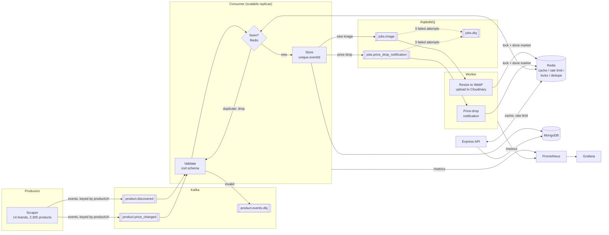

# Event pipeline architecture

## Delivery guarantees (design)

These are what the design provides. The handler and worker logic is covered by unit tests; the end-to-end behaviour under a real crash is what `npm run failuretest` is for, and it has not been run yet.

| Hop | Guarantee | How |
|---|---|---|
| Scraper → Kafka | no duplicate writes on broker retry | idempotent producer, `acks=-1` |
| Kafka → consumer | at-least-once | offset committed only after the handler resolves |
| Consumer → Mongo | effectively-once | deterministic `eventId` + unique index; Redis check is a fast path, not the source of truth |
| Consumer → RabbitMQ | at-least-once | jobs re-offered after a retried store |
| Worker | effectively-once | Redis lock (no concurrent run) + done-marker (no re-run) |
| Poison messages | never block a partition | schema failures and exhausted retries go to a DLQ with the reason |

## Ordering

Events are keyed by `productUrl`, so events of the **same type** for one product share a partition and stay in order.

`discovered` and `price_changed` are different topics, and Kafka does not order across topics, so a price change can be
processed before the discovery it follows. The store therefore guards every state update with the event's `occurredAt`:
an older event can never overwrite a newer price (covered by `pipeline/test/store.test.js`, and checked again by the load test).

## Failure behaviour

| Failure | Result |
|---|---|
| Consumer SIGKILL mid-batch | group rebalances; uncommitted messages redelivered; duplicates absorbed by dedupe/unique index |
| Redis down or flushed | consumer falls back to the Mongo unique index; API cache and rate limit fail open |
| Mongo write fails | 3 retries with backoff, then DLQ with the error |
| Broker down at scrape time | scraper logs and continues (events for that batch are dropped, the scrape itself is unaffected) |
| Worker job throws | retried up to 3 times, then `jobs.dlq` |
