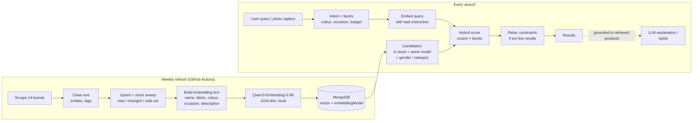

# How retrieval (RAG) works in AuraFit

RAG = **retrieve** the relevant products first, then let rules and an LLM work only on what was retrieved.
AuraFit already had this shape; the embedding model was the only part that needed replacing.

## Was a big architecture change needed?

No. Only three places ever produced embeddings, so the change is one module.

| Part | Before | Now |
|---|---|---|
| Embedding model | MiniLM via Hugging Face API (384-dim, English, paid credits ran out) | **Qwen3-Embedding-0.6B**, in-process, 1024-dim, multilingual, no API key |
| Query vs document | same text both sides | queries carry a task instruction, documents are plain text (what Qwen3 is trained for) |
| Stored vector | no record of which model made it | every row stores `embeddingModel`; search only compares vectors from the current model |
| Re-embedding | manual script, API calls | `embedPending` finds rows with no vector **or an old model** and fixes them; part of the weekly run |
| Candidate set | first 400 rows per catalog, re-read from Mongo on every query | whole catalog, cached in memory as Float32 for 5 minutes |
| Stock | ignored by search | sold-out products excluded from every search path |

Unchanged: scraping, text cleaning, the facet/hybrid scoring, constraint relaxation, the recommender and the stylist flows.

## Why Qwen3-Embedding

- **Multilingual**: product text and queries mix English with Roman Urdu terms (shalwar, dupatta, lehnga), where an English-only MiniLM is weak.
- **Instruction-aware**: you tell it the task ("retrieve fashion products matching this query"), which improves retrieval.
- **Local and free**: runs on CPU through transformers.js, so no key, no quota and no extra server. The same code works on a laptop and on a CI runner.
- Measured here: about 0.2 s per text on CPU, 1024 dimensions, sensible similarities (query "black embroidered lawn suit" vs a lawn-suit description 0.62, vs a heels description 0.40).

### Costs to know about

- **Memory**: the quantised model needs roughly 1-2 GB of RAM inside whatever process embeds. The weekly job runs it on a CI runner (fine). For the **API server**, query embedding also needs the model; on a small host (for example a 512 MB free tier) run it on a larger instance or move query embedding into a small separate service.
- **First start** downloads about 600 MB (cached afterwards in `backend/.model-cache`).
- **Switching models** later only means changing `EMBEDDING_MODEL_ID`/repo: `npm run embed:all` then re-embeds everything stale. Vectors of different models are never mixed.

## Searching on shorter vectors (measured)

Qwen3-Embedding is trained so the first N dimensions of a vector are themselves a usable embedding. Stored vectors stay 1024-dim; search truncates
and re-normalises them (`EMBEDDING_SEARCH_DIMS`, default 256), and the database sends only those numbers (`$slice`). Measured on the 35-query golden set
(`npm run eval:search`):

| Dims | Precision@10 | Recall@10 | MRR | nDCG@10 | Payload / memory |
|---|---|---|---|---|---|
| 1024 | 0.809 | 0.842 | 0.946 | 0.892 | 1x |
| 512 | 0.794 | 0.827 | 0.945 | 0.881 | 0.5x |
| **256 (default)** | 0.806 | 0.838 | 0.948 | 0.885 | **0.25x** |
| 128 | 0.768 | 0.799 | 0.945 | 0.862 | 0.125x |

256 is within noise of full size at a quarter of the data. Caveat: 35 queries is a small set; re-run the eval before changing it.

## Pictures: CLIP image vectors

Text vectors cannot tell a print or a silhouette. Each product photo also gets a CLIP vector (`Xenova/clip-vit-base-patch32`, 512-dim, local, ~150 ms/image;
`npm run embed:images`, resumable). CLIP puts images and sentences in one space, so:

* **photo search** compares the uploaded picture with every product picture and fuses that ranking with the description-based one (reciprocal-rank fusion);
* text-to-image works with the same vectors (verified: "gold earrings", "a pair of shoes", "a lawn suit dress", "a wrist watch" each ranked the right catalog photo first).

## What is still brute force, and when that stops being fine

Ranking is exact cosine in Node over cached candidates. Measured (`npm run bench:vectors`, synthetic unit vectors, this laptop):

| Products | 256-dim p95 | 1024-dim p95 | Memory (256 / 1024) |
|---|---|---|---|
| 3,400 (today) | 4.5 ms | 12 ms | 3 / 14 MB |
| 20,000 | 25 ms | 87 ms | 20 / 82 MB |
| 100,000 | 153 ms | 539 ms | 102 / 410 MB |

So an index is **not needed** at today's size, and not before roughly 50k products at 256 dims. Past that, move candidates into a vector index
(Atlas Vector Search or pgvector); the provider, model tagging and weekly job stay as they are. This is step 2.2 in [PLAN.md](PLAN.md): measured, deliberately not built.

## The weekly loop

`npm run refresh:catalog` (scheduled in `.github/workflows/weekly-refresh.yml`):

1. scrape clothing, shoes, watches, jewelry (new products are inserted, changed ones updated);
2. sweep: products no longer on the retailer's site are marked out of stock, **unless the run looks blocked or incomplete** (then nothing is marked and a warning is logged);
3. embed everything new or changed;
4. print a summary, and fail the job if a catalog lost most of its in-stock products or any embedding failed.
